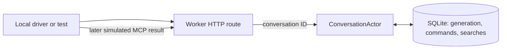

# Conversation actor experiment

This isolated experiment uses a Cloudflare Durable Object with SQLite storage to coordinate one voice conversation. It does not run the realtime voice transport or call the LexLatam MCP service. `search_panama_law` results are deterministic fixtures delivered through a separate command.

Run this experiment locally only. Its HTTP endpoints have no authentication or authorization, so anyone who knows a conversation ID could read or change that conversation's state if the Worker were deployed publicly. Do not deploy it publicly without adding both checks.



## Run locally

From `experiments/conversation-actor/`, with Node 22.12.0 or newer:

```sh
npm ci
npm run typecheck
npm test
npm run demo
```

The test and demo each start a local Wrangler runtime and use ignored `.scratch/` storage. They need no account, API key, or live service. For manual requests, run `npm run dev` in one terminal, then use `http://127.0.0.1:8787/conversations/example` in another. `GET` reads state; `POST` accepts commands such as:

```json
{"type":"start_turn","commandId":"turn_1"}
{"type":"start_search","commandId":"search_1","callId":"call_1","generation":1,"query":"Panama law"}
{"type":"interrupt","commandId":"interrupt_1"}
{"type":"complete_search","commandId":"result_1","callId":"call_1","results":[{"title":"Simulated legal source","citation":"SIM-1","excerpt":"Deterministic result."}]}
```

Each JSON line above is a separate POST body. Restart `npm run dev` and repeat a GET to inspect the same local SQLite state.

## Model

The Worker routes a conversation ID to one Durable Object ID. That object owns the conversation's generation counter, processed command IDs, and search calls. Each command applies synchronously in one SQLite transaction. A repeated command ID returns its recorded result; a repeated call ID cannot create a second search. Starting another turn or interrupting advances the generation. A result for an earlier generation is marked `stale`, and its sources are discarded.

A command ID identifies one immutable operation. Retries must send the same payload with the same ID; use a new ID for a different operation. This experiment does not compare retry payloads: if an ID is reused with different content, the actor returns the first recorded response and does not apply the new content.

The search is a two step protocol: `start_search` records `pending` and returns immediately; the local driver later sends `complete_search`. This lets other commands proceed while the simulated external search is outstanding. It also makes the limit clear: **SQLite persists state, but this experiment does not persist or resume execution of an in-flight network request.** After a runtime restart, a pending search remains pending until a caller delivers a result. There is no automatic MCP connection, retry, timeout, or recovery process.

This is an actor because a stable conversation identity routes messages to a single owner that serializes changes to its private state. The pending search is one event in a longer stateful conversation, rather than a standalone background job. The SQLite transaction makes each command atomic, but it does not cover time between search start and result delivery; generation checks coordinate that interval.

The existing Node sideband handler remains separate. It keeps call IDs and turn generations in memory, and discards stale research before prompting another response. This experiment explores what changes when those coordination facts are persisted per conversation, without importing the Node MCP SDK into the Workers runtime.
